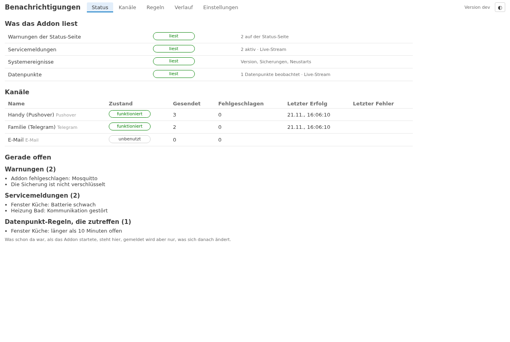
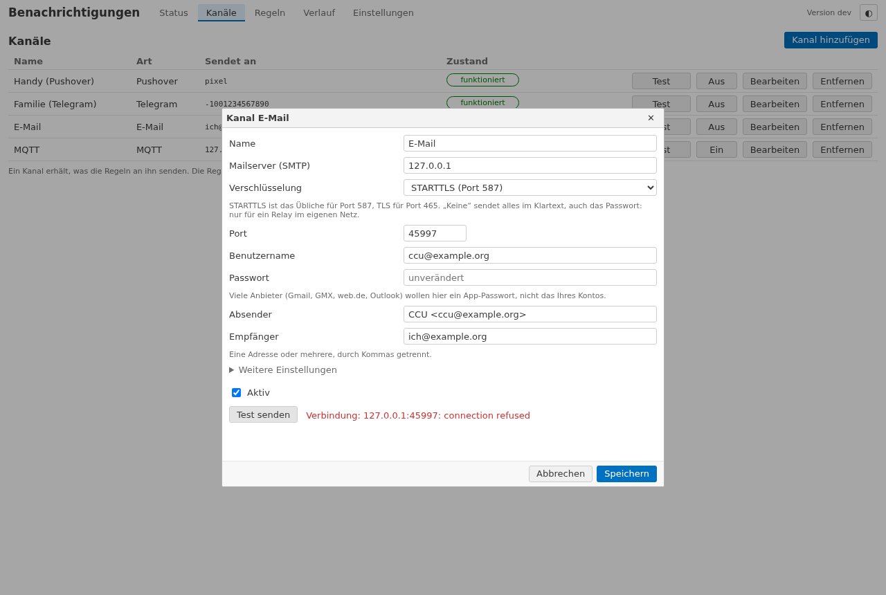
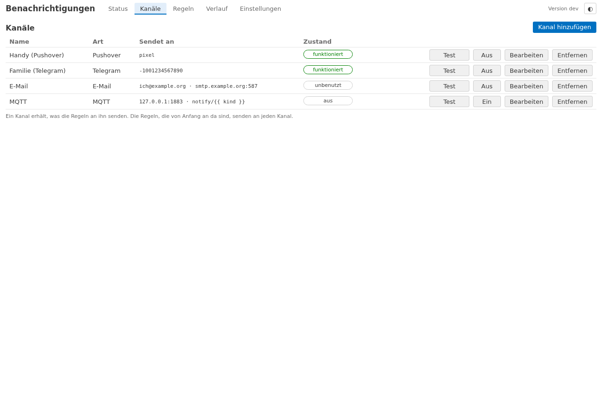
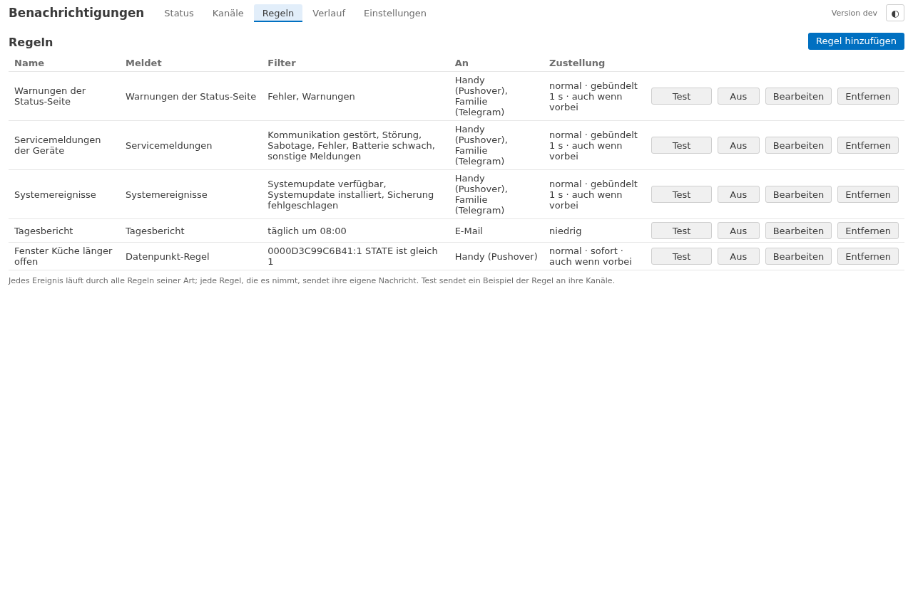
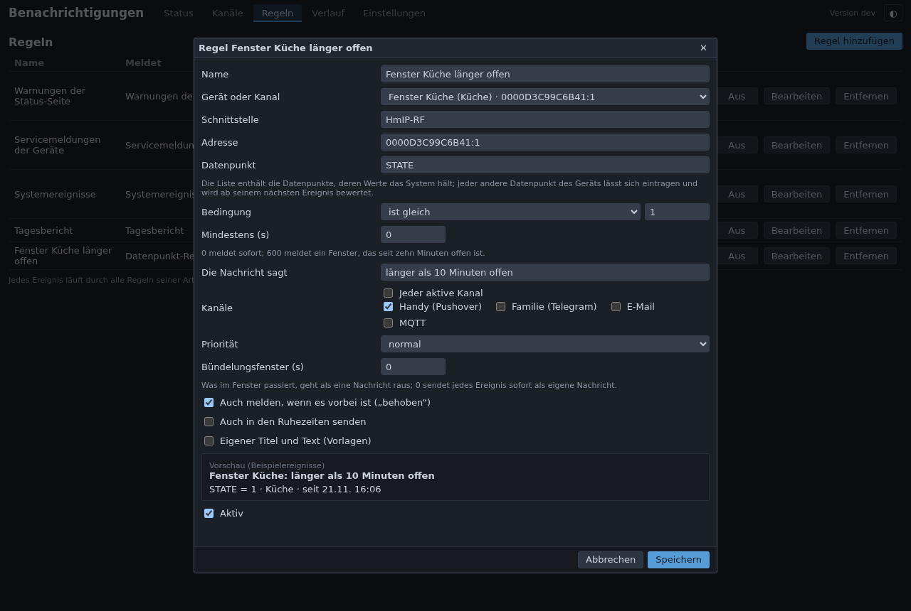
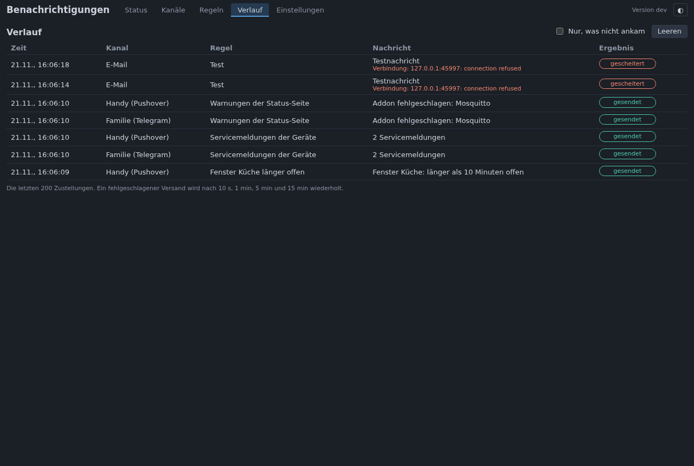
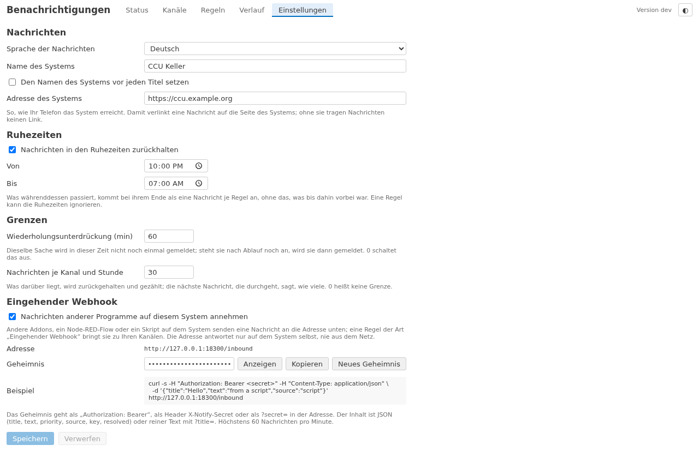
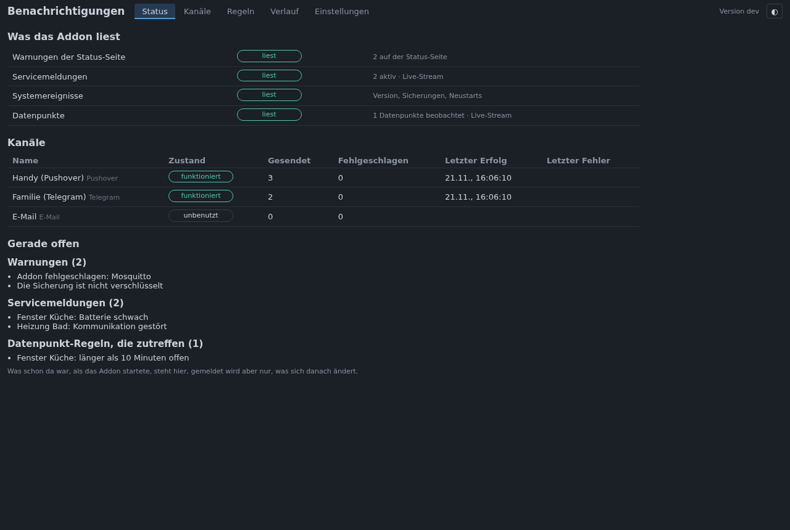

# lite-addon-notify

*[Deutsch](README.md)*

> **Needs openccu-lite 1.2.0 or later.**

**Notifications** for [openccu-lite](https://github.com/openccu-lite/openccu-lite): the addon tells you what the
system knows, where you read it - the Status page's warnings, the devices' service messages, datapoint rules of your
own, system events and a daily digest; by Pushover, Telegram, email, ntfy, Gotify, Signal, Discord, Slack, Matrix, a
webhook or MQTT. No programs, no scripts, no extra automation system.



## What it reports

| Source | What |
| --- | --- |
| **Status page warnings** | every warning of the system, when it appears and when it is resolved: an addon that failed, a service in a restart loop, a storage medium wearing out, a certificate about to expire, … The notices other addons post on the Status page (batteries, backup targets) arrive the same way |
| **Device service messages** | communication disturbed, battery low, sabotage and faults, configuration or firmware update pending - new and resolved, with the device's name and room |
| **Datapoint rules** | a condition of your own on a datapoint: is true or false, equals, above or below a threshold - if you like only once it has held for a time ("window open for more than ten minutes", "temperature below 5 °C") |
| **System events** | system update available, update installed, backup made (from openccu-lite 2.0.0), backup failed, system restarted |
| **Daily digest** | once a day at the time you choose: "all clear", or what is open |
| **Inbound webhook** | messages from other programs on the system (below) |

What is already there when the addon starts for the first time is not reported - only what changes afterwards.

## Where it sends

| Channel | What you need |
| --- | --- |
| **Pushover** | the API token of an application of your own and your user key |
| **Telegram** | a bot's token (@BotFather) and the chat id |
| **Email** | an SMTP server: STARTTLS (587), TLS (465) or unencrypted (25), with or without a login |
| **ntfy** | a topic on ntfy.sh or your own server, an access token or user and password if needed |
| **Gotify** | the server's address and an application token |
| **Signal** | a [signal-cli REST server](https://github.com/bbernhard/signal-cli-rest-api) you run, with a registered number |
| **Discord, Slack** | the URL of an incoming webhook |
| **Matrix** | the URL of a webhook bridge in the room (a generic webhook of matrix-hookshot, say) |
| **Webhook** | a URL; the message goes as JSON, or you build the body with a template |
| **MQTT** | a broker - the Mosquitto on the system when you name none; topic and payload are templates |

Every channel has a **Test button** that sends a test message with what the form holds and says in clear what does
not work: the name does not resolve, the connection is refused, the certificate is not trusted, the server offers no
STARTTLS, the login is refused, the sender or a recipient is rejected - each with the server's own answer.



## Rules

A rule is **a source, a filter and the channels it sends to**. Three rules are there from the start (warnings,
service messages, system events) and send to every channel: the first channel you add receives everything that
matters at once. The daily digest is there, switched off.

- **Filter:** severities and warnings to leave out; kinds of service messages and devices to leave out; which system
  events.
- **Batching:** what happens within the window (60 s by default) goes out as *one* message. A message that comes and
  goes within the window is not sent at all.
- **Hold time for service messages:** a message must stand that long (2 min by default) before it counts - a device
  that does not answer for a moment stays silent.
- **Quiet hours:** what happens meanwhile arrives as one message per rule when they end, without what was over by
  then. A rule can ignore the quiet hours.
- **Repeat suppression:** the same matter is not announced again within the time you set (60 min by default); if it
  still stands afterwards, it is announced then.
- **Rate limit:** at most that many messages per channel and hour (30 by default); the next message says how many were
  held back.
- **Priority** low, normal, high - mapped to each channel's own scale.
- **"Resolved" messages**, which a rule can switch off.
- **Templates** for title and body in Jinja syntax (`{{ headline }}`, `…`), with a
  preview in the dialog.

A failed send is tried again after 10 s, 1 min, 5 min and 15 min. The **History** shows the last 200 deliveries with
the reason of every failure; a channel that keeps failing shows as a notice on the system's Status page.

## Installation

1. Install the package `notify-<arch>-<version>.tar.gz` from the
   [releases page](https://github.com/openccu-lite/lite-addon-notify/releases) on the system's Addons page - or from
   the catalogue, once the system lists the addon there.
2. On the addon's page (*Notifications* in the addon menu), add a channel under **Channels** and check it with **Send a
   test**.
3. Done: the three default rules send to every channel. Under **Rules** you set what you want to hear and add
   datapoint rules; under **Settings** the language of the messages, the system's name and address (for links in the
   messages), quiet hours and limits.

## The inbound webhook

Other programs on the system - another addon, a Node-RED flow, a script - send a message to

```
POST http://127.0.0.1:8300/inbound
```

and a rule of the kind *Inbound webhook* takes it to your channels. The address answers **on the system itself only**,
never from the network, is off until you switch it on in the settings, and wants the secret shown there
(`Authorization: Bearer …`, the header `X-Notify-Secret` or `?secret=`).

```sh
curl -s -H "Authorization: Bearer $SECRET" -H 'Content-Type: application/json' \
  -d '{"title":"Washing machine done","text":"Programme finished","source":"house"}' \
  http://127.0.0.1:8300/inbound
```

The body is JSON (`title`, `text`, `priority`, `link`, `source`, `key`, `resolved`) or plain text with `?title=`.
`source` is what a rule filters by (also as `?source=` in the address); with `key` and a later `resolved: true` a
sender closes its own message. An addon with a webhook target that sends a title and a text as JSON can point here
unchanged. Details in [docs/api.md](docs/api.md).

## What the addon may do and where it connects

The addon runs as its own user without privileges and opens no port to the network. It only **reads** from the
system: the warnings, the service messages, the update and backup state (`system:read`), the values of the datapoints
you make rules for (`rpc:read`; the event stream is open only while a datapoint rule exists), and names and rooms
(`meta:read`). It switches and changes nothing.

It connects to nothing until you add a channel, and after that only to that channel's target - with the message's
text: device names, rooms and the system's name go to the channel's provider. The channels' credentials are in
`/usr/local/etc/config/addons/notify/notify.json` (mode 0600) and so in every backup of the system; the page never
shows them again. An uninstall leaves the configuration for a reinstall.

## Screenshots

| | |
| --- | --- |
|  |  |
|  |  |
|  |  |

## Development

```sh
go test -race ./...                         # the Go tests: every channel against a mock, the rules with a fake clock
NOTIFY_DOCKER=1 go test -count=1 -run Mosquitto ./internal/channel/   # MQTT against a real Mosquitto in Docker
(cd ui && npm ci && npm run check && npm test && npm run build)
(cd ui && npx playwright test)              # the page against the fake system (scripts/dev-serve.sh)
VERSION=0.1.0 scripts/build.sh              # the packages for aarch64, x86_64 and armv7l
```

`scripts/dev-serve.sh` starts the daemon against a small demo system: the page at
`http://127.0.0.1:18300/addons/notify/`; a channel with the address `http://127.0.0.1:18080/sink/x` sends into its
sink (`GET /dev/sink` shows what arrived), `POST /dev/warnings` and `POST /dev/messages` set warnings and service
messages. The page's API and the inbound webhook are in [docs/api.md](docs/api.md).

## Licence

MIT. See [LICENSE](LICENSE).
