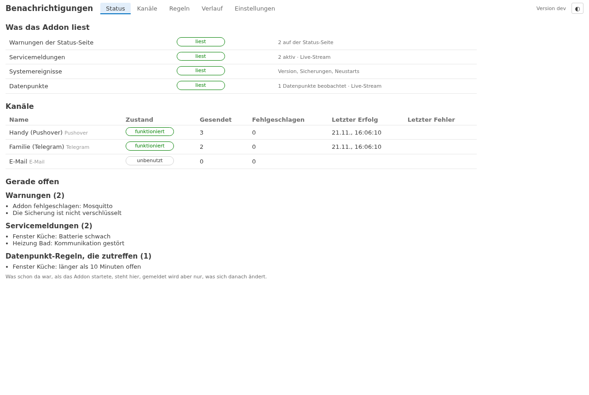
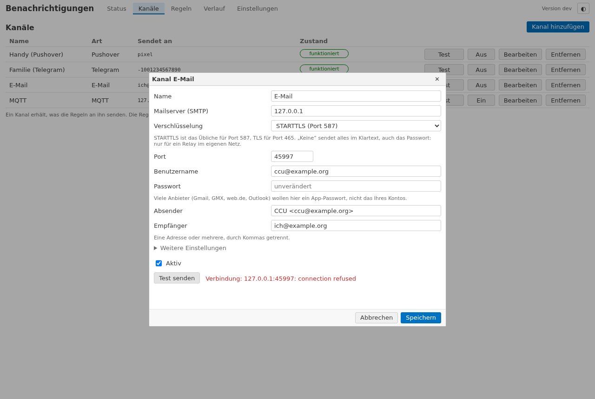
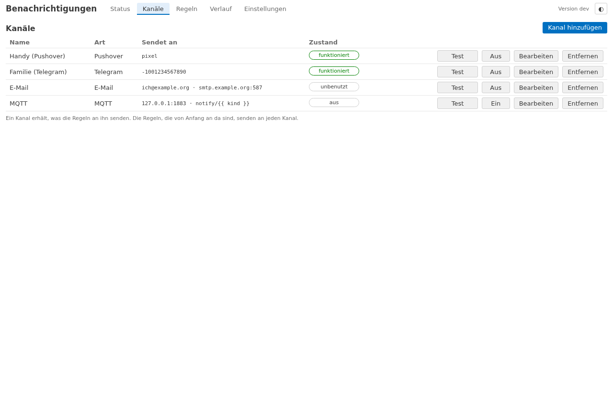
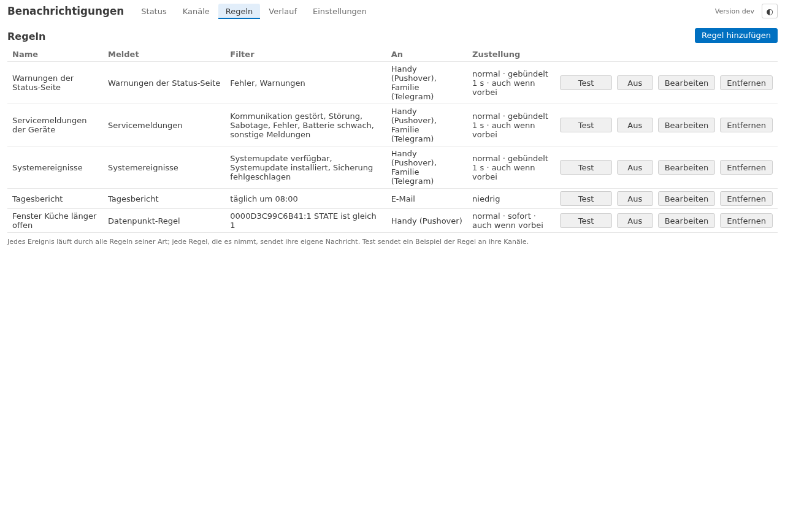
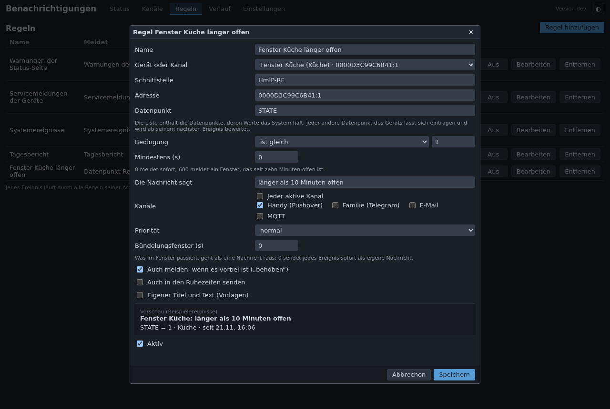
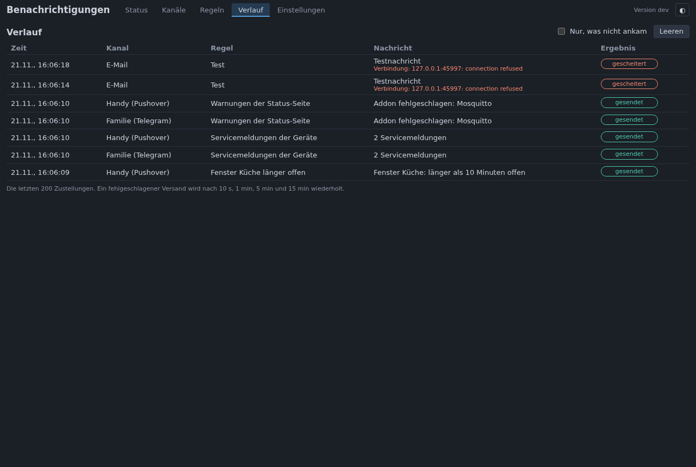
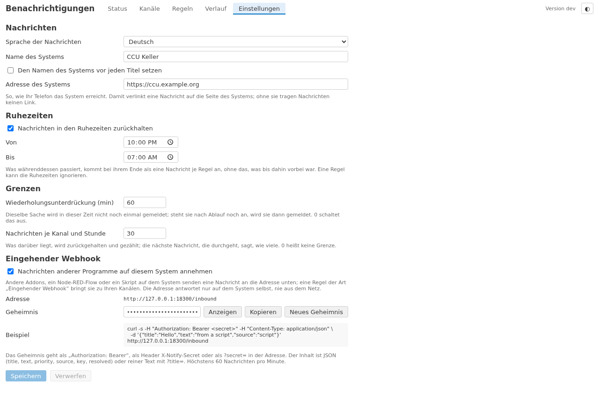
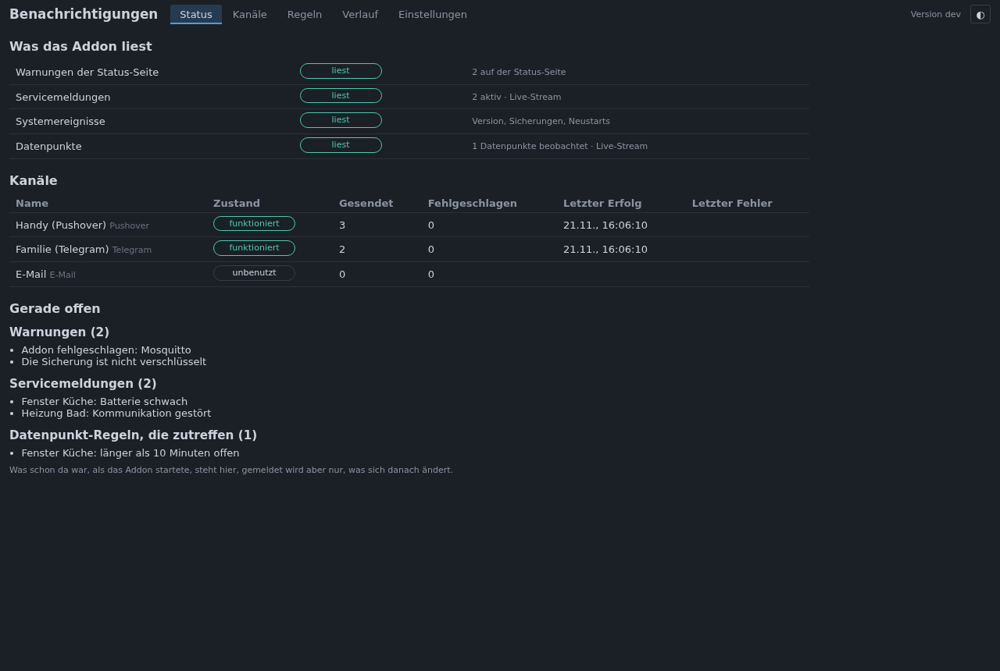

# lite-addon-notify

*[English](README.en.md)*

> **Braucht openccu-lite 1.2.0 oder neuer.**

**Benachrichtigungen** für [openccu-lite](https://github.com/openccu-lite/openccu-lite): Das Addon meldet, was das
System weiß, dorthin, wo Sie es lesen – die Warnungen der Status-Seite, die Servicemeldungen der Geräte, eigene
Datenpunkt-Regeln, Systemereignisse und einen Tagesbericht; per Pushover, Telegram, E-Mail, ntfy, Gotify, Signal,
Discord, Slack, Matrix, Webhook oder MQTT. Ohne Programme, ohne Skripte, ohne ein zusätzliches Automationssystem.



## Was es meldet

| Quelle | Was |
| --- | --- |
| **Warnungen der Status-Seite** | jede Warnung des Systems, wenn sie auftritt und wenn sie behoben ist: ein fehlgeschlagenes Addon, ein Dienst in der Neustartschleife, ein alterndes Speichermedium, ein ablaufendes Zertifikat, … Auch die Hinweise, die andere Addons auf die Status-Seite legen (Batterien, Sicherungsziele), kommen so an |
| **Servicemeldungen der Geräte** | Kommunikation gestört, Batterie schwach, Sabotage und Störungen, Konfiguration oder Firmware-Update steht an – neu und behoben, mit Gerätename und Raum |
| **Datenpunkt-Regeln** | eine eigene Bedingung auf einen Datenpunkt: ist wahr oder falsch, ist gleich, über oder unter einer Schwelle – auf Wunsch erst, wenn sie eine Zeit lang gilt („Fenster länger als zehn Minuten offen“, „Temperatur unter 5 °C“) |
| **Systemereignisse** | Systemupdate verfügbar, Update installiert, Sicherung erstellt (ab openccu-lite 2.0.0), Sicherung fehlgeschlagen, System neu gestartet |
| **Tagesbericht** | einmal am Tag zur gewählten Zeit: „Alles in Ordnung“ oder was offen ist |
| **Eingehender Webhook** | Nachrichten anderer Programme auf dem System (siehe unten) |

Was schon da ist, wenn das Addon zum ersten Mal startet, wird nicht gemeldet – nur, was sich danach ändert.

## Wohin es sendet

| Kanal | Was Sie brauchen |
| --- | --- |
| **Pushover** | das API-Token einer eigenen Anwendung und Ihren Benutzerschlüssel |
| **Telegram** | das Token eines Bots (@BotFather) und die Chat-ID |
| **E-Mail** | einen SMTP-Server: STARTTLS (587), TLS (465) oder unverschlüsselt (25), mit oder ohne Anmeldung |
| **ntfy** | ein Topic auf ntfy.sh oder dem eigenen Server, bei Bedarf Zugriffs-Token oder Benutzer und Passwort |
| **Gotify** | die Adresse des Servers und ein Anwendungs-Token |
| **Signal** | einen [signal-cli-REST-Server](https://github.com/bbernhard/signal-cli-rest-api), den Sie betreiben, mit registrierter Nummer |
| **Discord, Slack** | die URL eines eingehenden Webhooks |
| **Matrix** | die URL einer Webhook-Brücke im Raum (etwa ein generischer Webhook von matrix-hookshot) |
| **Webhook** | eine URL; die Nachricht geht als JSON, oder Sie bauen den Inhalt mit einer Vorlage |
| **MQTT** | einen Broker – ohne Angabe der Mosquitto auf dem System; Topic und Nutzlast sind Vorlagen |

Jeder Kanal hat einen **Test-Knopf**, der eine Testnachricht mit dem sendet, was gerade im Formular steht, und im
Klartext sagt, was nicht geht: Der Name lässt sich nicht auflösen, die Verbindung wird abgelehnt, das Zertifikat ist
nicht vertrauenswürdig, der Server bietet kein STARTTLS, die Anmeldung wird abgelehnt, der Absender oder ein Empfänger
wird zurückgewiesen – jeweils mit der Antwort des Servers.



## Regeln

Eine Regel ist **eine Quelle, ein Filter und die Kanäle, an die sie sendet**. Drei Regeln sind von Anfang an da
(Warnungen, Servicemeldungen, Systemereignisse) und senden an jeden Kanal: Der erste Kanal, den Sie anlegen, bekommt
also sofort alles Wichtige. Der Tagesbericht ist angelegt und ausgeschaltet.

- **Filter:** Schweregrade und auszulassende Warnungen; Arten von Servicemeldungen und auszulassende Geräte; welche
  Systemereignisse.
- **Bündelung:** Was innerhalb des Fensters passiert (Standard 60 s), geht als *eine* Nachricht raus. Eine Meldung,
  die im Fenster kommt und wieder geht, wird gar nicht gesendet.
- **Wartezeit für Servicemeldungen:** Eine Meldung muss so lange anstehen (Standard 2 min), bevor sie zählt – ein
  Gerät, das kurz nicht antwortet, bleibt still.
- **Ruhezeiten:** Was währenddessen passiert, kommt bei ihrem Ende als eine Nachricht je Regel, ohne das, was bis
  dahin vorbei war. Eine Regel kann die Ruhezeiten ignorieren.
- **Wiederholungsunterdrückung:** Dieselbe Sache wird innerhalb der eingestellten Zeit (Standard 60 min) nicht noch
  einmal gemeldet; steht sie danach noch an, wird sie dann gemeldet.
- **Mengenlimit:** höchstens so viele Nachrichten je Kanal und Stunde (Standard 30); die nächste Nachricht sagt, wie
  viele zurückgehalten wurden.
- **Priorität** niedrig, normal, hoch – auf die Skala des jeweiligen Kanals übersetzt.
- **„Behoben“-Nachrichten**, je Regel abschaltbar.
- **Vorlagen** für Titel und Text in Jinja-Syntax (`{{ headline }}`, `…`), mit
  Vorschau im Dialog.

Ein fehlgeschlagener Versand wird nach 10 s, 1 min, 5 min und 15 min wiederholt. Der **Verlauf** zeigt die letzten
200 Zustellungen mit dem Grund jedes Fehlers; ein Kanal, der dauerhaft scheitert, erscheint als Hinweis auf der
Status-Seite des Systems.

## Installation

1. Das Paket `notify-<arch>-<version>.tar.gz` von der
   [Releases-Seite](https://github.com/openccu-lite/lite-addon-notify/releases) über die Addons-Seite des Systems
   installieren – oder aus dem Katalog, sobald das System das Addon dort führt.
2. Auf der Addon-Seite (*Benachrichtigungen* im Addon-Menü) unter **Kanäle** einen Kanal anlegen und mit **Test
   senden** prüfen.
3. Fertig: Die drei Standardregeln senden an jeden Kanal. Unter **Regeln** stellen Sie ein, was Sie hören wollen, und
   legen Datenpunkt-Regeln an; unter **Einstellungen** die Sprache der Nachrichten, den Namen und die Adresse des
   Systems (für Links in den Nachrichten), Ruhezeiten und Grenzen.

## Der eingehende Webhook

Andere Programme auf dem System – ein anderes Addon, ein Node-RED-Flow, ein Skript – senden eine Nachricht an

```
POST http://127.0.0.1:8300/inbound
```

und eine Regel der Art *Eingehender Webhook* bringt sie zu Ihren Kanälen. Die Adresse antwortet **nur auf dem System
selbst**, nie aus dem Netz, ist aus, bis Sie sie in den Einstellungen einschalten, und verlangt das dort angezeigte
Geheimnis (`Authorization: Bearer …`, der Header `X-Notify-Secret` oder `?secret=`).

```sh
curl -s -H "Authorization: Bearer $SECRET" -H 'Content-Type: application/json' \
  -d '{"title":"Waschmaschine fertig","text":"Programm beendet","source":"haus"}' \
  http://127.0.0.1:8300/inbound
```

Der Inhalt ist JSON (`title`, `text`, `priority`, `link`, `source`, `key`, `resolved`) oder reiner Text mit `?title=`.
`source` ist das, wonach eine Regel filtert (auch als `?source=` in der Adresse); mit `key` und später
`resolved: true` schließt ein Absender seine eigene Meldung. Ein Addon mit einem Webhook-Ziel, das Titel und Text als
JSON sendet, lässt sich ohne Änderung hierher richten. Einzelheiten in [docs/api.md](docs/api.md).

## Was das Addon darf und wohin es sich verbindet

Das Addon läuft als eigener Benutzer ohne Zusatzrechte und öffnet keinen Port im Netz. Vom System **liest** es nur:
die Warnungen, die Servicemeldungen, den Update- und Sicherungsstand (`system:read`), die Werte der Datenpunkte, für
die Sie Regeln anlegen (`rpc:read`; der Ereignisstrom ist nur offen, solange es eine Datenpunkt-Regel gibt), und Namen
und Räume (`meta:read`). Es schaltet und ändert nichts.

Es verbindet sich mit nichts, bis Sie einen Kanal anlegen, und danach nur mit dessen Ziel – mit dem Text der
Nachricht: Gerätenamen, Räume und der Name des Systems gehen an den Anbieter des Kanals. Die Zugangsdaten der Kanäle
liegen in `/usr/local/etc/config/addons/notify/notify.json` (Modus 0600) und damit in jeder Sicherung des Systems; die
Seite zeigt sie nie wieder an. Ein Deinstallieren lässt die Konfiguration für eine Neuinstallation liegen.

## Screenshots

| | |
| --- | --- |
|  |  |
|  |  |
|  |  |

## Entwicklung

```sh
go test -race ./...                         # die Go-Tests: jeder Kanal gegen einen Mock, die Regeln mit einer falschen Uhr
NOTIFY_DOCKER=1 go test -count=1 -run Mosquitto ./internal/channel/   # MQTT gegen einen echten Mosquitto in Docker
(cd ui && npm ci && npm run check && npm test && npm run build)
(cd ui && npx playwright test)              # die Seite gegen das System-Double (scripts/dev-serve.sh)
VERSION=0.1.0 scripts/build.sh              # die Pakete für aarch64, x86_64 und armv7l
```

`scripts/dev-serve.sh` startet den Daemon gegen ein kleines Demo-System: Seite unter
`http://127.0.0.1:18300/addons/notify/`; ein Kanal mit der Adresse `http://127.0.0.1:18080/sink/x` sendet in dessen
Senke (`GET /dev/sink` zeigt, was ankam), `POST /dev/warnings` und `POST /dev/messages` setzen Warnungen und
Servicemeldungen. Die API der Seite und des eingehenden Webhooks steht in [docs/api.md](docs/api.md).

## Lizenz

MIT. Siehe [LICENSE](LICENSE).
